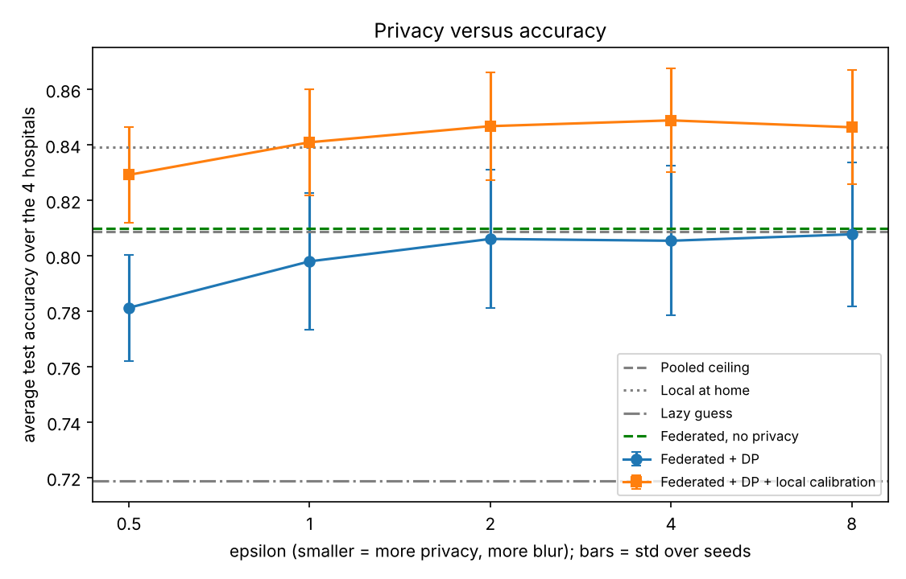
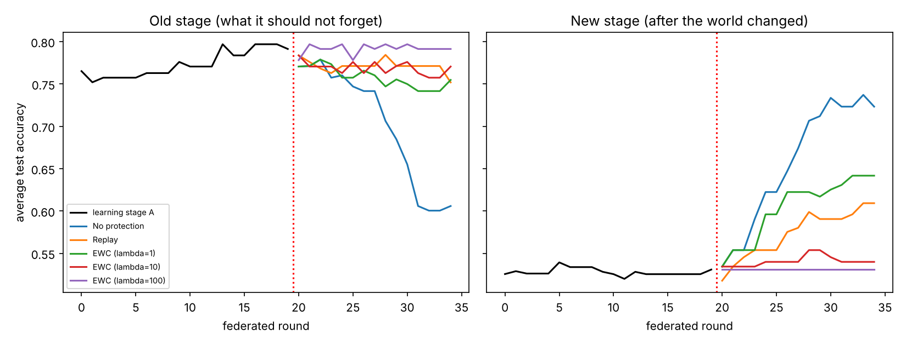

<div align="center">

# Learning together, privately

**Federated continual feature stores with differential privacy and concept-drift handling**

Four hospital datasets, one shared heart-disease model, no patient record ever pooled.

[](LICENSE)


[](https://doi.org/10.5281/zenodo.24096856)
[Showcase PDF](docs/showcase.pdf) | [Study guide](docs/guide_from_scratch.pdf) | [Full report](docs/report.md) | [Theory notes](docs/theory.md) | [Results](results/summary.md)

</div>

---

## In one minute

Hospitals cannot pool patient records, so each trains alone, and a model that has only seen one hospital learns that hospital's habits. We simulate four hospitals from the public UCI Heart Disease data (920 patients) and ask four questions: can they share one model, can they do it privately, what happens when medicine changes, and what can we honestly claim?

| What we found | Number |
|---|---|
| Shared feature definitions lift the federated model | **+8.4 points** [7.4, 9.4], better in 10 of 10 runs |
| Federated learning versus the (illegal) pooled ceiling | 0.1 points apart |
| Privacy cost, logistic regression | none visible at epsilon 2 or more; 1.2 points at epsilon 1 |
| Forgetting after simulated drift | 33 points unprotected, 10 with replay |
| What did **not** work | private feature-store summaries; the alarm on gentle drift; Switzerland still below the lazy guess |

This is a simulation on public data. It is not a clinical result.



## The problem in plain words

Hospitals want to build better AI models together, but privacy laws stop them from pooling patient records. At the same time, medicine keeps changing through new diseases and new treatments, so a model that was accurate last year can become outdated. This project designs a shared feature store that lets many institutions keep their models current over time, with a mathematical privacy guarantee for individual patients and with protection against the model forgetting what it already knew.

## The four ideas this project combines

| Idea | Plain-English meaning |
|---|---|
| Federated learning | Each hospital trains on its own records and shares only what the model learned, never the records themselves. |
| Differential privacy | Carefully measured noise is added so that no single patient's presence or absence can be detected from the output. |
| Continual learning | The model keeps learning from new data over time without erasing earlier knowledge (avoiding catastrophic forgetting). |
| Concept drift | The relationship between patient information and outcomes changes over time, so the system must notice and adapt. |

The **feature store** is the shared, versioned list of model inputs (for example age or blood pressure) and how they are prepared, so every institution uses the same definitions without exchanging raw records.

## Research questions

1. How much accuracy is lost as privacy is tightened (smaller epsilon) in a federated setting?
2. How much does a model forget when the data changes over time, and how well do continual-learning methods reduce this?
3. How quickly can the system detect drift and recover?
4. What privacy and forgetting guarantees can be stated, and how well do experiments support them?

## What we did

- Simulated four hospitals from the public UCI Heart Disease data (Cleveland, Hungary, Switzerland, VA Long Beach; 920 patients).
- Compared local training, a pooled ceiling, and federated learning with and without a shared feature store, then added differential privacy (DP-SGD with a Renyi-DP accountant) at five privacy levels.
- Built a versioned shared feature store where hospitals share only counts, sums and sums of squares.
- Simulated concept drift at three strengths, ran a drift alarm (DDM), measured forgetting, and compared replay with EWC.
- Repeated the main comparisons with a small neural network, with 10 random seeds throughout and paired 95% intervals.
- Stated the privacy guarantee and drift bound with their assumptions (`docs/theory.md`), and labelled every other claim as measured.

## Repository structure

```
federated-feature-store/
  README.md          Project overview (this file)
  requirements.txt   Python packages used
  data/              Dataset notes (raw data is not stored in this repository)
  notebooks/         Colab and Jupyter notebooks, numbered in order
  src/fedfs/         Reusable project code (see src/README.md)
  tests/             Unit and smoke tests
  results/           Result tables and figures
  docs/              Plan, glossary and report drafts
```

## Getting started

One command runs everything (feature store, local / pooled / federated, privacy sweep, drift, forgetting, stress test):

```
pip install -r requirements.txt
python -m fedfs.run_all --raw data/raw --out results --download
```

Results appear in `results/summary.md`, with tables and figures per model in `results/logistic/` and `results/mlp16/`. Or open `notebooks/03_run_everything.ipynb` in Colab.
To check the code works without any data: `python -m fedfs.run_all --synthetic --out /tmp/dry` (fake data, never report it).
Tests: `pip install pytest && pytest`.

## What is implemented

| Piece | Where |
|---|---|
| Versioned feature store, shared summaries, optional noisy summaries | `src/fedfs/feature_store.py` |
| Federated averaging | `src/fedfs/federated.py` |
| DP-SGD with a Renyi-DP accountant | `src/fedfs/privacy.py`, `federated.py` |
| Drift simulation and DDM alarm | `src/fedfs/drift.py` |
| Replay and EWC against forgetting | `src/fedfs/federated.py` |
| Logistic regression and small neural network (shared interface) | `src/fedfs/models.py` |
| Experiments, figures, runner | `src/fedfs/experiments.py`, `plots.py`, `run_all.py` |
| What is proven versus measured | `docs/theory.md` |
| Report with real results and limitations | `docs/report.md` |

## Tools

Python, NumPy, scikit-learn, Pandas, Matplotlib. The federated loop, DP-SGD accountant, drift detector, replay and EWC are implemented from scratch so every step can be read and explained. Flower, Opacus and River are optional cross-checks (see `requirements.txt`).

## Data and privacy note

No patient-level data is stored in this repository. Datasets are downloaded from their original sources under their own licences and access terms. MIMIC-IV and eICU are not used in this study; if the work is extended to them, access requires PhysioNet credentialing and must follow their data use agreements.

## Headline results (real UCI data, 10 seeds)

| Finding | Number |
|---|---|
| Local helpers lose accuracy away from home | 83.9% at home, 69.0% away |
| Shared feature store lifts federated accuracy | +8.4 points [7.4, 9.4], better in 10 of 10 seeds |
| Federated matches the pooled (illegal) ceiling | +0.1 points [-0.7, 0.9] |
| A federated model alone loses at Switzerland (93% sick) | 77.3% vs 93.2% local; one local offset per hospital closes the gap |
| Cost of privacy (logistic regression) | none visible at epsilon 2 or more; 1.2 points at epsilon 1; 2.9 at epsilon 0.5 |
| Making the shared summaries private too | **failed**: accuracy fell below the lazy guess (negative result) |
| Forgetting after simulated drift | 33 points unprotected; replay 10; EWC about 0 but barely learns the new stage |
| Drift alarm | caught strong drift in 8 of 10 seeds, gentle drift in only 3 of 10 |




Full details, limits and the proven-versus-measured split are in `docs/report.md` (also `docs/report.pdf`) and `docs/theory.md`.

This is a simulation on public data with simulated drift. It is not a clinical result and is not ready for clinical use.

## Limitations (short version)

Public data split by site rather than real hospital streams; drift chosen by us; small models; the privacy guarantee covers training only; heavy missing data at three of the four sites; Switzerland has about 37 test patients, so its numbers are very noisy.

## Cite

See `CITATION.cff`.

## Where to read more

| If you want | Open |
|---|---|
| A quick, good-looking overview | [`docs/showcase.pdf`](docs/showcase.pdf) |
| To understand everything from zero | [`docs/guide_from_scratch.pdf`](docs/guide_from_scratch.pdf) |
| The full write-up with limits | [`docs/report.md`](docs/report.md) |
| What is proven versus measured | [`docs/theory.md`](docs/theory.md) |
| Plain-English definitions | [`docs/glossary.md`](docs/glossary.md) |
| Who did what | [`CONTRIBUTIONS.md`](CONTRIBUTIONS.md) |
| Version history | [`CHANGELOG.md`](CHANGELOG.md) |

## Authors

| | ORCID | GitHub |
|---|---|---|
| Harshita Pandita | [0009-0002-4479-0473](https://orcid.org/0009-0002-4479-0473) | [@hersheyharshi](https://github.com/hersheyharshi) |
| Pranjal Tomar | [0009-0004-6638-2424](https://orcid.org/0009-0004-6638-2424) | [@Pranjaltomar07](https://github.com/Pranjaltomar07) |

See [`CONTRIBUTIONS.md`](CONTRIBUTIONS.md) for the split of work.

## Licence

Code: MIT (see `LICENSE`). The UCI Heart Disease data is not included; it is downloaded from the UCI repository under its own terms (CC BY 4.0).
